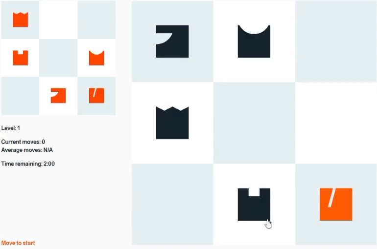

# Royal Blitz

Royal Blitz is a timed browser puzzle game inspired by the board game "The Royal Study". The player must rearrange chess pieces on a 3x3 board to match a target position before the timer reaches zero.

This project was created as part of the Ironhack WebDev Bootcamp.

[Play the game →](https://eloygarciacv.github.io/royal-blitz/)

## Credits

- Web design and development by Eloy García
- Typography Areal by Dinamo Typefaces
- Game design based on The Royal Study by Stan van Rooijen
- Chess icons design based on the Chess Matt Edition by Lee Jinwook

## Ironhack Core Requirements

The project must:

1.  Use only HTML, CSS, and plain JavaScript. It must run entirely in the browser without frameworks or a backend.
    _— I lowkey missed Tailwind CSS but all good ✌️_
2.  Use DOM manipulation and browser events for the game's interactions and animations.
    _— Yeah, it have some of that._
3.  Use ES6 classes to model and organize game elements and their behavior.
    _— Okay, so I DO NOT HAVE classes. My first approach was to have them, but all my game elements are unique so it was a bit pointless to create classes and instances if all of them are different._
4.  Include distinct start, gameplay, and win/lose states.
    _— UX could definitely be better but where's the fun on that._
5.  Show clear feedback when the player wins or loses and provide a working way to restart the game.
    _— Sames as number 4, I guess. A very trendy number this days, btw._
6.  Keep HTML, CSS, and JavaScript in separate files and use clear, readable names and structure.
    _— This I think I got it right._
7.  Be stored in a GitHub repository with at least **two meaningful commits for every day you work on the project**.
    _— Nice._
8.  Be deployed online, for example with GitHub Pages, so that anyone with the link can play it.
    _— Yay! It's here: https://eloygarciacv.github.io/royal-blitz/_

## AI Usage

No agentic workflows or inline suggestions were used in this project.

GitHub Copilot was used for:

- Explaining errors and assisting with debugging.
- Translating pseudocode into JavaScript.
- Making complex CSS selectors.
- Learning about new JavaScript methods and syntax, such as `some()` and `[...array]`.
- Translating TypeScript code into JavaScript for better understanding.

## Resources

- [Code a Chess Game with Stockfish API – Angular & TypeScript Tutorial](https://www.youtube.com/watch?v=fJIsqZmQVZQ) by Roberts Tech (freeCodeCamp)
- [Code CHESS in JavaScript](https://www.youtube.com/watch?v=Qv0fvm5B0EM) by Ania Kubów
- [chess.js – TypeScript chess library](https://www.npmjs.com/package/chess.js) by Jeff Hlywa
